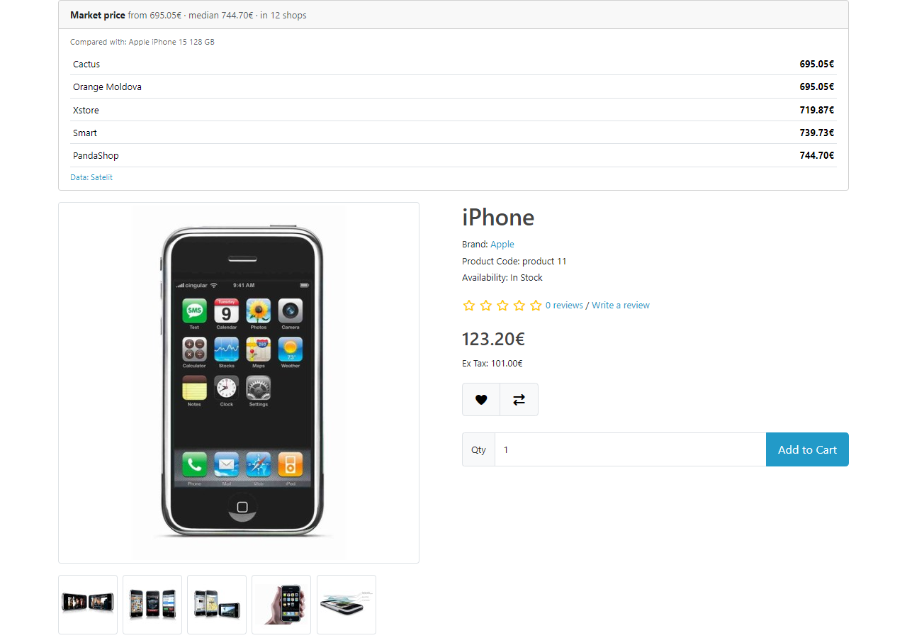
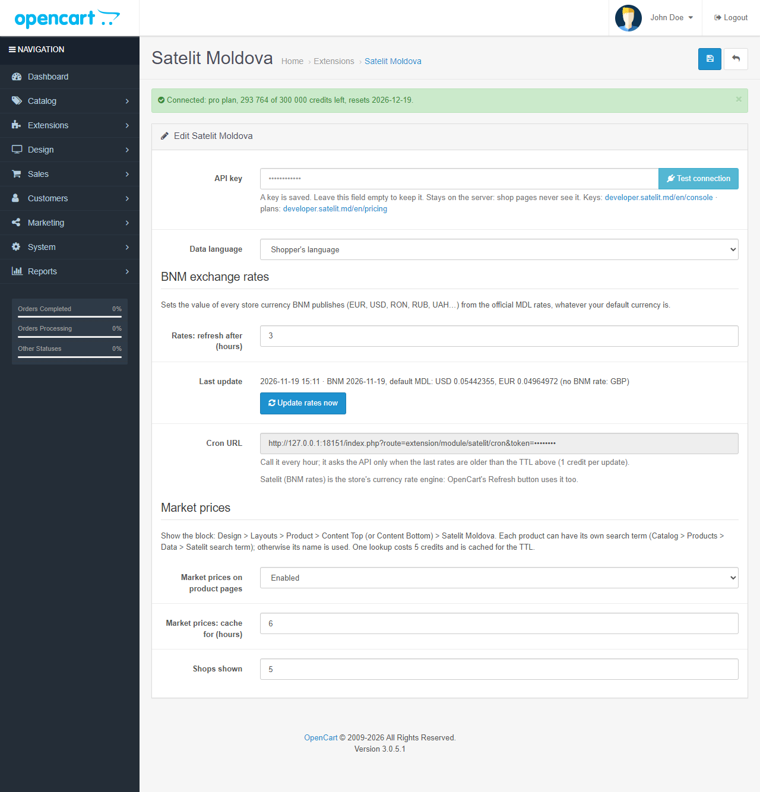
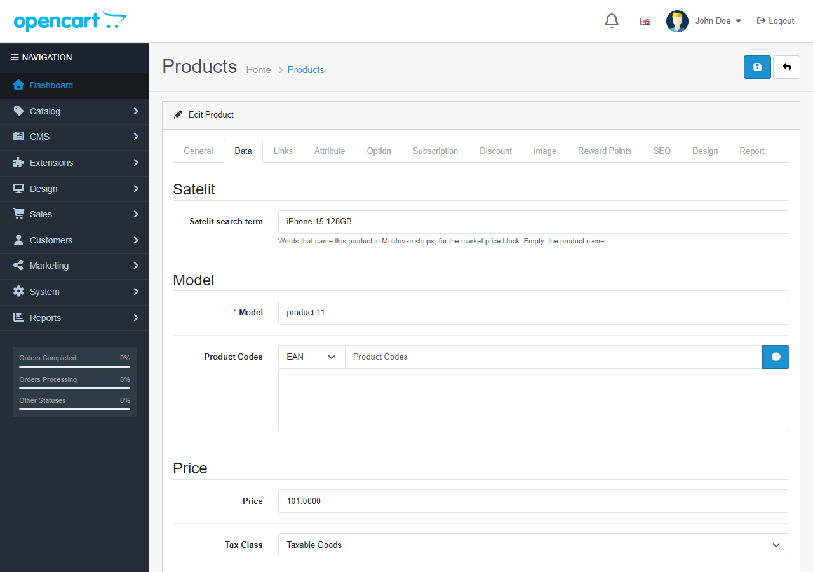

# Satelit for OpenCart

Official National Bank of Moldova (BNM) exchange rates for your store currencies, and a **"Market price"** block on product pages with offers from Moldovan shops, through the [Satelit API](https://developer.satelit.md/en/docs/). One package for OpenCart 3.0.x, one for OpenCart 4.x.



Real output from a test store (OpenCart 3.0.5.1, default currency MDL), after **Update rates now**:

```
2026-11-19 15:11 · BNM 2026-11-19, default MDL: USD 0.05442355, EUR 0.04964972 (no BNM rate: GBP)
```

and the block on the iPhone product page (search term `iPhone 15 128GB`):

```
Market price  from 13,999.00lei · median 14,999.00lei · in 12 shops
Compared with: Apple iPhone 15 128 GB
Cactus 13,999.00lei · Orange Moldova 13,999.00lei · Xstore 14,499.00lei · Smart 14,899.00lei · PandaShop 14,999.00lei
Data: Satelit
```

## What it does

**BNM exchange rates.** Sets the value of every store currency BNM publishes (EUR, USD, RON, RUB, UAH, …) from `/v1/rates`. BNM quotes MDL per `nominal` units. The extension converts that to OpenCart's model (the default currency is 1, every other currency is "units per 1 unit of the default"), so it works whatever your default currency is:

| Default currency | EUR stored as | MDL stored as | USD stored as |
|---|---|---|---|
| MDL | `nominal / value` (1 / 20.1411 = 0.04964972) | 1 | 1 / 18.3744 |
| EUR | 1 | 20.1411 | 20.1411 / 18.3744 = 1.09615008 |

Currencies BNM does not list (GBP in the demo store) are left alone and named in the log line. If the default currency itself has no BNM rate, nothing changes.

It uses each version's own mechanism:

- **OpenCart 4.x**: a currency rate engine (`Extensions > Currency > Satelit (BNM rates)`). Enabling it makes it the store's engine, so OpenCart's **Refresh** button on the currency list, saving a currency, and the built-in `currency` cron task all use BNM rates.
- **OpenCart 3.0.4+ (tested on 3.0.5.1; 3.0.3.x has no rate engines, see below)**: the same, as an OpenCart 3 currency extension. The Refresh button and "Auto Update Currency" use it.
- **All versions**: **Update rates now** in the settings and a cron URL with a secret token (`…&token=…`), which calls the API only when the last rates are older than the TTL.

**Market prices.** A layout module for the product page (Content Top or Content Bottom): it searches Satelit for the product, opens the best match and shows the lowest and median price, the number of shops and the cheapest offer of up to N shops, each with the shop name. Each product can have its own **Satelit search term** (a field added to the product form, Data tab). Otherwise its name is used. Prices come in MDL and are shown in the shopper's currency when the store has MDL, otherwise as `lei`.

**Admin settings** (`Extensions > Modules > Satelit Moldova`): API key (password field, never shown again, kept when left empty), data language (shopper's language or a fixed one: ro, ru, en, uk), rates TTL, prices TTL, number of shops, status, **Test connection** (plan and credits left, from `/v1/me`, 0 credits), the last rates log line and the cron URL. Admin strings in en-gb, ro-ro and ru-ru. Storefront strings in the same three.



## Requirements

- OpenCart 3.0.x or 4.x (see "Tested with"), PHP with `curl` (falls back to `file_get_contents`) and `json`.
- A Satelit API key. There is no free plan: try the data first with the keyless `/v1/sample` or the [console](https://developer.satelit.md/en/console/), then pick a plan on the [pricing page](https://developer.satelit.md/en/pricing/).

## Install

Build the packages (or take them from a release):

```bash
python tools/build.py
# dist/opencart-3/satelit-opencart3.ocmod.zip
# dist/opencart-4/satelit.ocmod.zip   (OpenCart 4 needs this exact name: it is the extension code)
```

**OpenCart 4.x**

1. `Extensions > Installer > Upload` `satelit.ocmod.zip`, then press the green install button on its row.
2. `Extensions > Extensions > Modules > Satelit Moldova`: Install, then Edit: paste the key, **Test connection**, Save.
3. `Extensions > Extensions > Currency > Satelit (BNM rates)`: Install, Edit, Status on, Save (this makes it the store's rate engine).
4. `Design > Layouts > Product`: add **Satelit Moldova** to Content Top (or Content Bottom), Save.

**OpenCart 3.0.x**

1. `Extensions > Installer > Upload` `satelit-opencart3.ocmod.zip`.
2. `Extensions > Extensions > Modules > Satelit Moldova`: Install, Edit, key, Test connection, Save.
3. On 3.0.4+: `Extensions > Extensions > Currency > Satelit (BNM rates)`: Install, Edit, Status on, Save.
4. `Design > Layouts > Product`: add **Satelit Moldova** to Content Top, Save.

Uninstalling the module removes its two tables (`satelit_cache`, `satelit_product`) and its events.

## Configure and use

- **Rates now**: `Satelit Moldova > Update rates now` (1 credit), or `System > Localisation > Currencies > Refresh` once the currency engine is on.
- **Rates on a schedule**: call the cron URL shown in the settings every hour, for example
  `0 * * * * curl -s "https://shop.example/index.php?route=extension/satelit/module/satelit.cron&token=…"`
  (OpenCart 3: `route=extension/module/satelit/cron`). It answers one JSON line, `{"ok":true,"message":"fresh"}` while the rates are younger than the TTL. Add `&force=1` to update now. A wrong token answers 403.
- **Search terms**: `Catalog > Products > edit > Data > Satelit search term`, e.g. `iPhone 15 128GB` for a product named "iPhone".



## Caching and credits

| What | API calls | Credits | Cached |
|---|---|---|---|
| Rates update | `GET /v1/rates` | 1 | rates TTL, 3 h by default (BNM publishes once a day) |
| Market prices for a product | `GET /v1/prices/search` + `GET /v1/prices/items/{id}` | 3 + 2 | prices TTL, 6 h by default, per search term and language; "no match" is cached too |
| Test connection | `GET /v1/me` | 0 | no |

The cache is the extension's own table, so a product page costs nothing until its entry expires. When the API fails (bad key, quota, network), the store keeps the last values, the product page shows the last cached copy or nothing, and the extension waits 10 minutes before calling again. Storefront calls time out after 5 s, admin calls after 8 s.

## Security

- The key is stored in OpenCart settings, only read on the server. The admin form never prints it back, and it is never sent to the storefront.
- Admin actions use OpenCart's `user_token` and check `modify` permission on the extension (and on `localisation/currency` for "Update rates now").
- All values from the API are escaped in the templates. The cron URL needs a random 32-character token compared with `hash_equals`.

## Troubleshooting

- **"key_invalid"** on Test connection: the key is wrong or revoked. Make a new one in the [console](https://developer.satelit.md/en/console/).
- **No block on the product page**: check the module status, that it is in the Product layout, and that the product's search term finds something (the extension caches "no match" for the prices TTL, saving the settings clears that cache).
- **Rates do not change**: the default currency must be MDL or a currency BNM lists. The log line under "Last update" says what happened. Errors also go to `System > Maintenance > Error Logs` as `Satelit …` lines.
- **OpenCart 3.0.3.x**: it has no currency rate engines, so use **Update rates now** or the cron URL, and turn off "Auto Update Currency" in `System > Settings > Option` (the feed it used no longer exists).
- **Upgrading on OpenCart 4**: uninstall both extensions, uninstall and delete the package in `Extensions > Installer`, then upload the new zip.

## Tested with

Verified on 19 Nov 2026 against the live API, installing the zip through `Extensions > Installer` the way a merchant does:

| Store | PHP | Database | Checks |
|---|---|---|---|
| OpenCart 3.0.3.9 (default currency USD, no rate engines) | 8.1.34 | MariaDB 10.11.19 | install, settings, Test connection, Update rates now, cron URL, product page, bad key, dead API |
| OpenCart 3.0.5.1 (default currency MDL) | 8.1.34 | MariaDB 10.11.19 | install, settings, Test connection, Update rates now, Refresh button, cron URL, search term, product page, bad key, dead API |
| OpenCart 4.1.0.4 (default currency EUR) | 8.2.36 | MariaDB 10.11.19 | the same |

Offline tests (`php tests/run.php`) pass on PHP 7.2 and 8.3.

## Development

```bash
php tests/run.php                 # offline: fake HTTP and database, fixtures from the live API
python tools/build.py --check     # the copies of shared/*.php are in sync
SATELIT_API_KEY=… php tests/live.php   # optional live smoke test (about 6 credits)
```

`shared/` holds the client and the store logic used by both versions; `tools/build.py` copies them into `opencart-3/upload/system/library/` and `opencart-4/satelit/system/library/` and writes the zips.

## Pe scurt (română)

Extensie pentru OpenCart 3.0.x și 4.x: pune în valutele magazinului cursurile oficiale BNM (prin `/v1/rates`, cu MDL ca bază, oricare ar fi valuta implicită) și arată pe pagina produsului blocul „Prețul pe piață”: prețul minim, mediana și magazinele din Moldova care vând produsul. Se instalează din `Extensions > Installer`, cheia se pune în `Extensions > Modules > Satelit Moldova`, cursurile se actualizează cu butonul „Actualizează cursurile acum”, cu butonul Refresh al OpenCart sau prin adresa pentru cron. Totul e păstrat în cache (cursurile 3 ore, prețurile 6 ore), iar dacă API-ul nu răspunde, magazinul merge mai departe. Interfața are traduceri în română, rusă și engleză.

## License

MIT, see [LICENSE](LICENSE). Rates: Sursa: Banca Națională a Moldovei, bnm.md, CC BY 4.0. Data: [Satelit](https://satelit.md).
